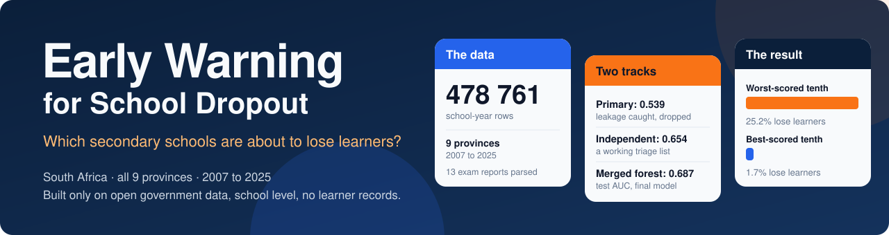
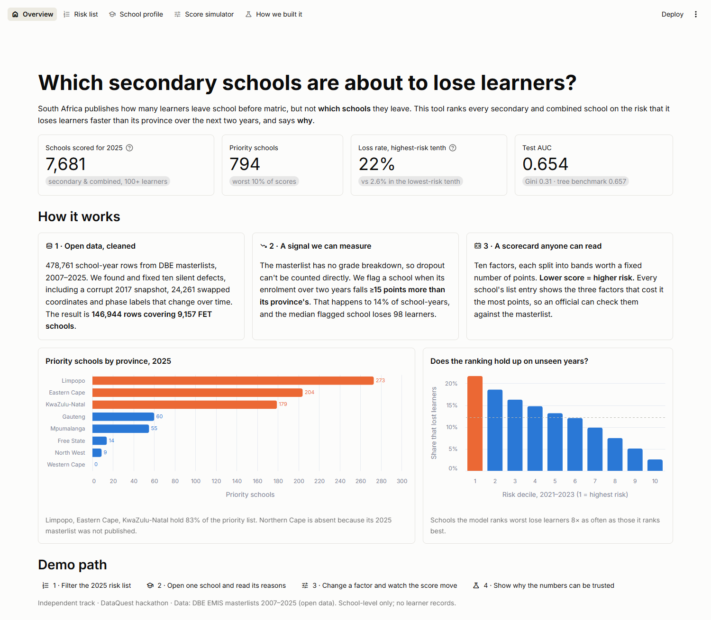
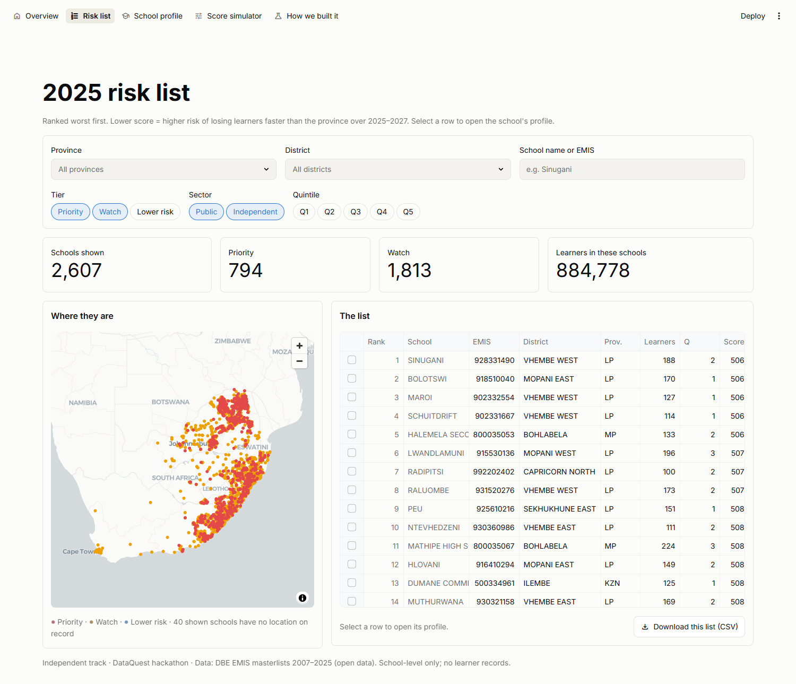
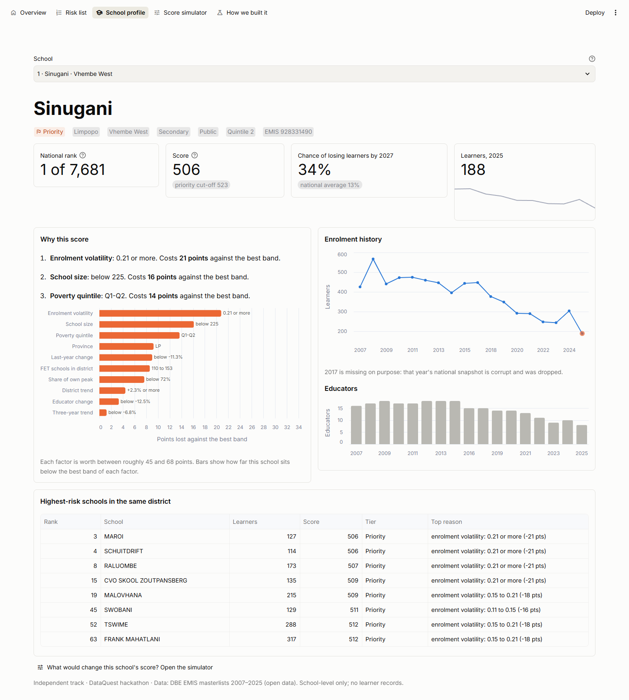
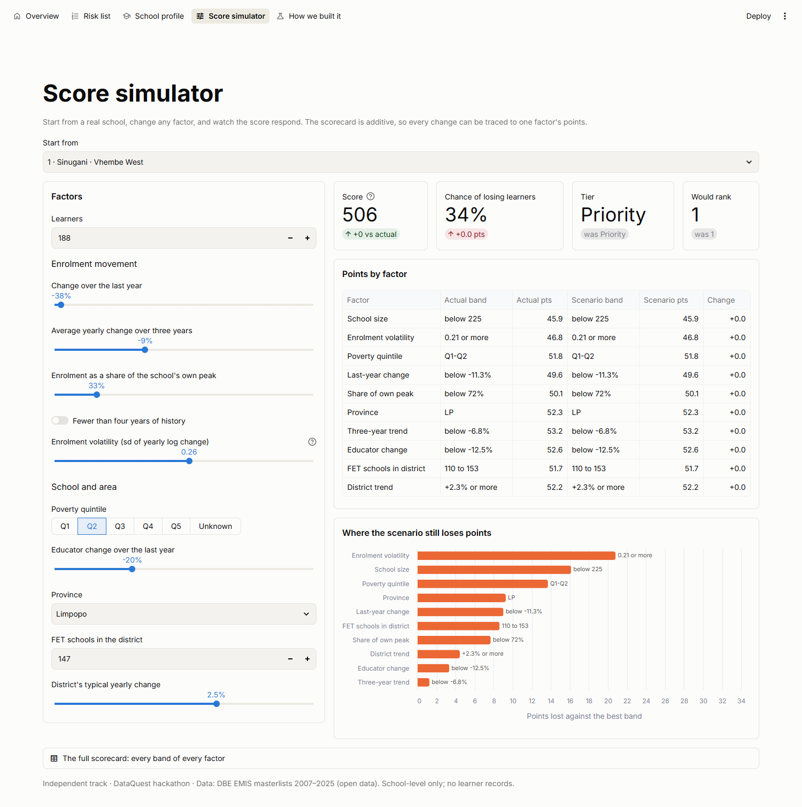
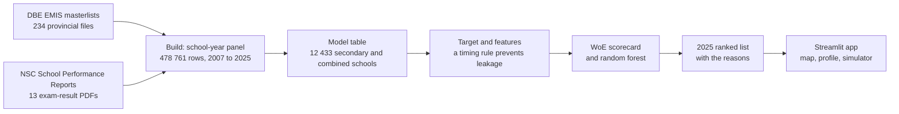

<p align="center">
  
</p>

<p align="center">
  
  
  
  
  
  
</p>

<p align="center">
  <a href="#what-it-does-and-why">What it does</a> &middot;
  <a href="#see-it">The app</a> &middot;
  <a href="#how-it-works">How it works</a> &middot;
  <a href="#two-teams-one-question">Two teams, one question</a> &middot;
  <a href="#results">Results</a> &middot;
  <a href="#honest-limits">Limits</a> &middot;
  <a href="#quick-start">Run it</a>
</p>

---

<table align="center">
  <tr>
    <td align="center"><b>478 761</b><br>school-year rows</td>
    <td align="center"><b>9</b><br>provinces, 2007 to 2025</td>
    <td align="center"><b>10</b><br>silent data defects<br>found and fixed</td>
    <td align="center"><b>0.687</b><br>test AUC,<br>merged forest</td>
    <td align="center"><b>80</b><br>tests</td>
  </tr>
</table>

## What it does, and why

Predicts, per school, how much of a Grade 10–12 cohort is at risk of being lost
before matric, so districts and NGOs can direct support to the schools most
likely to lose learners — before they leave, rather than counting them after.

About 40% of learners who start Grade 1 in South Africa never reach Grade 12
(DG Murray Trust, Zero Dropout Campaign). Attrition is steepest in Grades 10–12.
No widely deployed tool ranks schools by that risk ahead of time.

## See it

The app ranks every secondary and combined school for 2025 and explains each ranking in plain words. 7 681 schools are scored, and 794 of them are in the priority tier.

<table>
  <tr>
    <td width="50%"><br><sub><b>Overview.</b> The headline numbers, the three steps, and a chart showing the ranking holds up on years the model never saw.</sub></td>
    <td width="50%"><br><sub><b>Risk list.</b> Ranked worst first, filterable by province, district, tier, sector and quintile, with a map and a CSV download.</sub></td>
  </tr>
  <tr>
    <td><br><sub><b>School profile.</b> Rank, score, the factors that cost the most points, and the enrolment history, so an official can check it against the masterlist.</sub></td>
    <td><br><sub><b>Score simulator.</b> Change any factor and watch the score and the tier move.</sub></td>
  </tr>
</table>

## How it works



- **A signal that can be measured.** The masterlists have no grade breakdown, so dropout cannot be counted directly. A school is flagged when its enrolment over two years falls at least 15 points more than its province, which happens to 14% of school-years.
- **A scorecard anyone can read.** In the app, ten factors, each split into bands worth a fixed number of points. Every school entry shows the three factors that cost it the most points.
- **No leakage by design.** Predictors are built with a timing rule, and the test set is read once, at the end.

## Two teams, one question

Two teams worked the same raw data without seeing each other’s cleaning, target or model. That was deliberate: where two independent attempts agree, the result can be trusted, and where they disagree, the disagreement shows which decisions change the answer.

| | Primary track | Independent track | Merged |
|---|---|---|---|
| **Question** | Do fewer of this school’s learners reach matric than comparable schools? | Is this school’s enrolment falling faster than its province? | The independent target, with matric results as extra predictors |
| **Test AUC** | 0.539 | 0.654 | 0.661 scorecard, **0.687** random forest |
| **Verdict** | Barely above chance | A working triage list | The final model |

**Why the primary track failed.** Its target had enrolment in the denominator, so anything built from enrolment predicted it by construction, and the model learned to flag large schools. Removing the shortcut dropped the score from 0.600 to 0.539. Two further target definitions landed at 0.539 and 0.542. The report records the failure instead of dropping it.

**What the disagreement found:**
- **One year of national data is corrupt.** Enrolment falls by 1.44 million in 2017 and recovers by 1.31 million in 2018, which is a publication artefact. A target built on enrolment decline would have blamed thousands of schools for losses that never happened.
- **School phase labels are not stable.** 1 573 schools recorded as combined in 2016 are recorded as primary by 2023, which would have put about 1 800 schools with no Grade 10 to 12 learners into the population.
- **The modelling technique mattered more than the extra data.** The same features scored 0.567 through one team’s binning and 0.654 through the other’s: monotonic bin merging and information-value screening were worth about 0.09 AUC, more than every added feature combined.

## Results

Tuned on validation. The test set was read once, at the end. A result of 0.71 was rejected as leaky.

| Metric | Scorecard | Random forest | What it means |
|---|---|---|---|
| AUC | 0.661 | **0.687** | Ranking quality overall |
| Gini | 0.322 | 0.373 | The same information, scorecard convention |
| KS | 0.240 | 0.280 | Separation between the two score distributions |
| Recall | 0.628 | 0.622 | Of the schools that really lost learners, how many were caught |
| Precision | 0.181 | 0.199 | Of the schools flagged, how many really lost |
| Loss rate, worst-scored tenth | 22.6% | **25.2%** | How often the worst-scored schools really lose learners |
| Loss rate, best-scored tenth | 2.3% | **1.7%** | How often the best-scored schools do |
| Lift, worst tenth | 1.86x | 2.07x | Against the 12.2% base rate |

The separation is the number that matters. A planner working the top of the list is right about one time in four, against one in eight working at random.

## Honest limits

> [!WARNING]
> This is a **triage list, not a verdict.** AUC is 0.66 to 0.69, which separates schools usefully but not sharply.

- **The label is a proxy.** Enrolment decline cannot tell a learner who drops out from one who transfers to another school; both look identical in a headcount. Learners by grade per school, the real dropout label, is gated (SNAP microdata) and not in this repository.
- **Northern Cape has no 2025 row.** DBE’s page for it holds a Word template, not a masterlist.
- **Open data has silent defects.** Ten are listed under [Source defects](#source-defects-this-pipeline-corrects), each one fixed and pinned by a test.

## What this repository holds

Open government data, the scripts that fetch and assemble it, and the model
trained on the result. Coverage is **national — all nine provinces, 2007–2025**.

| Table | Rows | What it is |
|---|---|---|
| `datasets/processed/school_year_panel.csv.gz` | 478,761 | Every school, every year |
| `datasets/processed/model_table.csv` | 184,620 | Secondary + combined schools only — the training population (12,433 schools) |
| `datasets/processed/preview_2025.csv` | 8,654 | Latest year, small enough to open directly |

Raw downloads are **not** committed — several hundred MB, all re-downloadable
without a login. `src/fetch/` rebuilds them exactly.

## Quick start

```bash
pip install -r requirements.txt
python -m streamlit run app/Home.py
```


Note: `streamlit` is not on PATH on all machines. `python -m streamlit` always
works and is the form used throughout.

## Everything you can run

```bash
# The EDA app - explore the raw data, make and record cleaning decisions
python -m streamlit run app/Home.py

# Tests - cleaning rules, WoE/IV, and guards on the training table
python -m pytest tests/ -v

# Rebuild the data from source (only needed to refresh; takes a while)
python -m src.fetch.emis_masterlists   # 234 provincial masterlists from DBE
python -m src.fetch.nsc_reports        # 13 NSC School Performance Reports
python -m src.build.school_panel       # -> school_year_panel.csv.gz
python -m src.build.model_table        # -> model_table.csv
```

Every script runs as a module from the repository root. Running them as file
paths (`python src/build/model_table.py`) will fail on the `src.` imports.

## Layout

```
src/common/   paths and EMIS normalisation, shared by everything
src/fetch/    stage 1 - download raw data from DBE
src/build/    stage 2 - raw files into clean tables
src/model/    stage 3 - label, features, training, evaluation
tests/        pins the source defects listed below
datasets/     raw/ (gitignored) and processed/ (committed)
docs/         problem statement, business model, technical plan
outputs/      rankings, charts, trained model
```

## Source defects this pipeline corrects

None of these raise an error. Each one silently skews what a model would learn.

- **2019 files** spell the key column `NatEMIS`, every other year `NatEmis`.
  Exact matching drops the entire year while the panel still looks healthy.
- **Province codes are unstable** — KwaZulu-Natal appears as `KZ` and `KZN`,
  Gauteng as `GT` and `GP`, splitting two provinces into four.
- **Gauteng's 2023 file** has its key column headed `"G"`, truncated upstream.
  Recovered by inspecting values rather than trusting the header.
- **Quintile** is published as `3` in some years and `Q3` in others, plus a
  literal `TO BE UPDATED`. Untouched, a model treats `3` and `Q3` as unrelated.
- **Phase** is `Phase_PED` in recent files and `Phase_DoE` in older ones. Phase
  is what identifies a secondary school, so losing it loses the population this
  project is about.
- **Northern Cape 2025 Q2** on DBE's page is a Word template, not a masterlist.
  NC has no 2025 row. Nothing fixable at our end.

## Documentation

- `docs/problem.txt` — problem, solution, business model
- `docs/plan_v1.txt` — technical plan: features, label, modelling
- `datasets/INDEX.md` — data inventory, source by source
- `independent/` — the second team's independent track (own cleaning, target,
  scorecard, 2025 ranking and presentation app); start at `independent/README.md`.
  Run the app with `python -m streamlit run independent/app/streamlit_app.py`,
  and see `independent/DEMO.md` for the demo script

## Data sources and terms

Every input is a public, school-level file from the Department of Basic Education (EMIS masterlists, NSC School Performance Reports) or Stats SA (General Household Survey 2024). They remain under their publishers’ own terms; see [`datasets/INDEX.md`](datasets/INDEX.md) for each source. This repository holds no learner-level and no personal data.

## Licence

[MIT](LICENSE) for the code. The data keeps the terms of the organisations that publish it.
